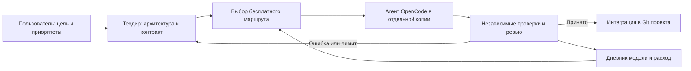

# Cat Herder — Пастух кошек

**Техдир руководит. Бесплатные модели пишут код через OpenCode. Результат принимается по проверкам.**

Cat Herder — проект о том, как организовать разработку с моделями разного качества и меняющимися квотами. Руководитель отвечает за архитектуру, небольшие задания, выбор исполнителя, проверку и интеграцию. Исполнители используют подтверждённые бесплатные маршруты; руководитель выбирается отдельно.

Основа уже опробована на двух Windows-играх: неоновом тетрисе и [«Луми и лабиринтах»](https://github.com/isyashin/lumi-maze). Здесь собираем методику, шаблоны и измеренные результаты, а затем развиваем переносимые средства оркестрации.

## Принципы

- Каждое приложение — отдельная папка со своим Git, `AGENTS.md` и документацией.
- Одно задание — небольшой разрешённый diff, исходный commit и проверяемый результат.
- Доступность маршрута и качество кода оцениваются раздельно. `429` — повод сменить маршрут, а не снизить оценку интеллекта модели.
- Ошибка исполнителя должна останавливаться до интеграции: отдельная копия, границы доступа, независимые проверки и ревью.
- Архитектура, интерфейсы и приёмка держатся в файлах. Длинный чат не заменяет память проекта.
- Бесплатные токены тоже ограничены. Короткий контекст, ограниченные попытки, минимум инструментов и измерение расхода.
- Параллельная работа разрешается для независимых задач и учитывает общую квоту провайдера.
- Платный fallback и смена тарифа требуют отдельного решения пользователя.

## С чего начать

1. Прочитать [процесс](docs/PROCESS.md) и [границы изоляции](docs/ISOLATION.md).
2. Создать отдельный репозиторий приложения и адаптировать [его AGENTS.md](templates/project/AGENTS.md).
3. Заполнить [контракт задания](templates/TASK.md).
4. Выбрать маршрут по [матрице](docs/MODELS.md) и [дневнику моделей](docs/MODEL_JOURNAL.md); сверить текущие условия провайдера.
5. Подготовить отдельную рабочую копию и проверить права до запуска.
6. Использовать [справку OpenCode](docs/OPENCODE.md), наблюдать stdout/stderr, проверить diff и результат самостоятельно.
7. Принять результат либо остановить попытку; заполнить [карточку оценки](templates/MODEL_REVIEW.md) и [передачу состояния](templates/HANDOFF.md).

## Содержимое

| Путь | Что внутри |
| --- | --- |
| [AGENTS.md](AGENTS.md) | Правила развития Cat Herder |
| [docs/PROCESS.md](docs/PROCESS.md) | Роли, контракты, проверки и интеграция |
| [docs/OPENCODE.md](docs/OPENCODE.md) | Проверенные команды и настройки OpenCode v2.0.30 |
| [docs/MODELS.md](docs/MODELS.md) | Как распределять задачи между моделями |
| [docs/FREE_SOURCES.md](docs/FREE_SOURCES.md) | Исторический обзор источников бесплатного доступа |
| [docs/MODEL_JOURNAL.md](docs/MODEL_JOURNAL.md) | Фактические результаты пилотов, включая неудачи |
| [docs/CONTEXT_BUDGET.md](docs/CONTEXT_BUDGET.md) | Контекст, кэш, квоты и счётчики |
| [docs/ISOLATION.md](docs/ISOLATION.md) | Что защищает основной проект и какие ограничения остаются |
| [templates/](templates/) | Задание, оценка модели, передача состояния, инструкции приложения |
| [examples/](examples/) | Конфигурации редактора/JSON-патчей и пример манифеста |
| [reference/windows/](reference/windows/README.md) | Экспериментальный Windows-пример пакетного запуска |
| [docs/ROADMAP.md](docs/ROADMAP.md) | Следующие этапы развития |

## Статус

Первый публичный срез — **23 октября 2026 года**. Методика и конфигурации использовались в пилотах. Переносимый runner, строгая изоляция отдельным пользователем/контейнером и автоматический учёт квот — следующие этапы. Windows-пример сохранён как текст для аудита: его ACL не являются полноценной границей безопасности.

Наличие модели в каталоге не гарантирует бесплатную доступность сегодня. Оценки в дневнике относятся к конкретным задачам и датам. Актуальное состояние — [STATUS.md](docs/STATUS.md).
